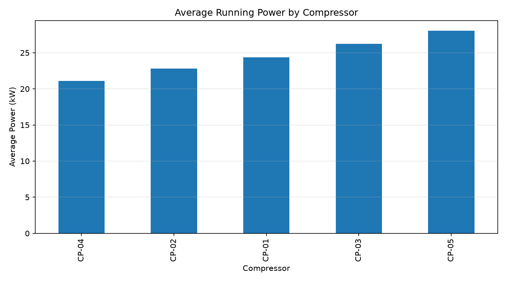
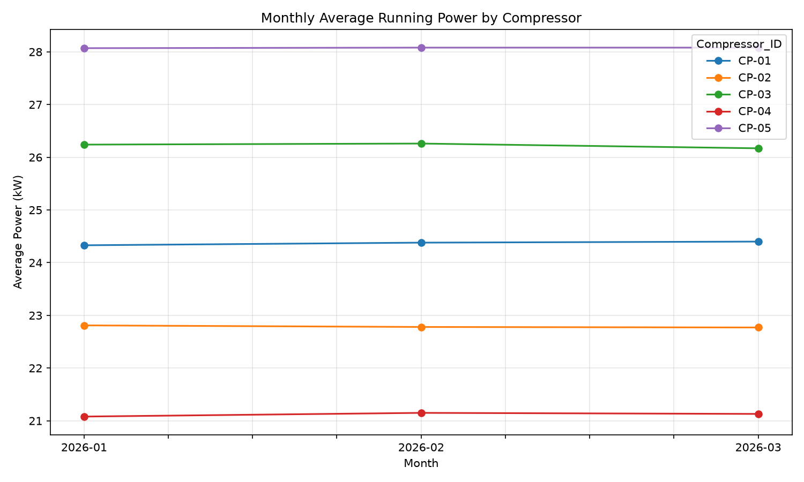
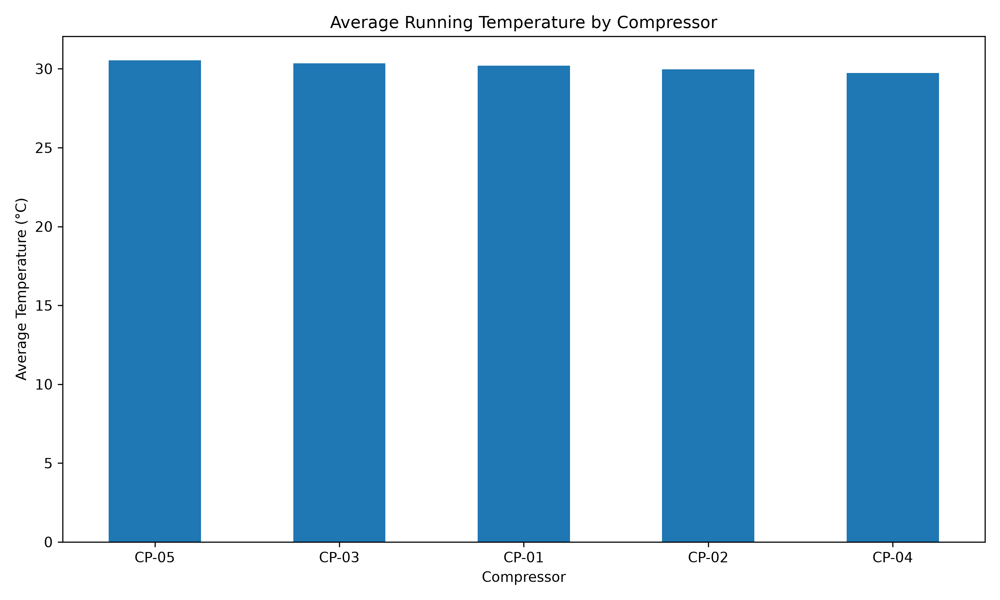
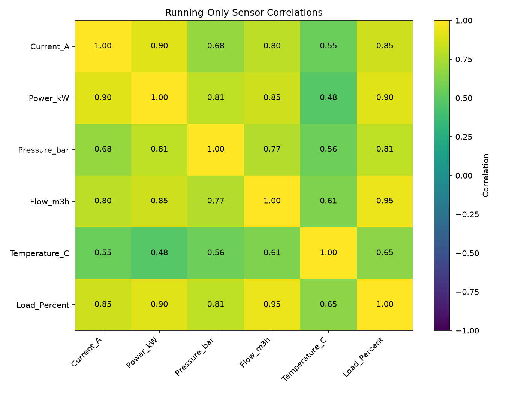

<div align="center">

# ⚙️ Industrial Compressor Energy Analytics

### Turning Industrial Sensor Data into Business Insights

**An End-to-End Data Analytics Portfolio Project**

<p>
  
  
  
  
</p>

<p>
  
  
  
  
</p>

---

*Exploring power consumption, airflow, operating load, sensor-data quality, and time-based patterns through Python, SQL, Excel, and Power BI preparation.*

</div>

> [!IMPORTANT]
> **Data integrity disclaimer:** All compressor readings in this project are synthetic and created for portfolio and learning purposes. They are not measurements from a real industrial plant. Energy figures are estimates, not verified energy consumption or demonstrated savings.

---

## 🧭 Table of Contents

- [🎯 Project Overview](#-project-overview)
- [💼 Business Problem](#-business-problem)
- [📊 Dataset](#-dataset)
- [🔄 Analytical Workflow](#-analytical-workflow)
- [🔍 Key Findings](#-key-findings)
- [📈 Visual Analysis](#-visual-analysis)
- [🐍 Python Analysis](#-python-analysis)
- [🗃️ SQL Analysis](#️-sql-analysis)
- [📊 Power BI](#-power-bi)
- [🛠️ Tools and Technologies](#️-tools-and-technologies)
- [📂 Project Structure](#-project-structure)
- [🚀 Getting Started](#-getting-started)
- [🗺️ Roadmap](#️-roadmap)
- [⚠️ Limitations](#️-limitations)
- [👤 Author](#-author)

---

## 🎯 Project Overview

Industrial compressors are important assets in process industries. Analysing their power, airflow, pressure, temperature, current, and load together can help uncover operating patterns and identify areas that deserve further investigation.

This project demonstrates how to transform raw sensor-style data into a structured analytical workflow using data cleaning, exploratory data analysis, SQL queries, business-oriented metrics, and visualisations.

The objective is not simply to create charts. It is to demonstrate how an analyst can move from raw data to **reliable measurements, meaningful comparisons, and clearly communicated findings.**

### ✨ What This Project Demonstrates

- 🧹 Data cleaning and quality validation
- 🔎 Missing-value and duplicate-record investigation
- 📉 Statistical outlier analysis
- 🐍 Python and Pandas-based exploratory analysis
- 🗃️ SQL queries for business-oriented questions
- 📊 Compressor-level KPI comparisons
- 📅 Time-based analysis and visualisation
- 📈 Preparation of data for Power BI reporting
- 💡 Interpretation of findings with appropriate limitations

---

## 💼 Business Problem

Industrial compressors operate under changing loads, airflow rates, pressures, temperatures, and operating conditions.

Looking at power consumption alone may not provide enough context to compare equipment fairly. Analysts need to investigate several variables together, understand data quality, and distinguish observations from conclusions.

### Business Questions

| # | Business question | Analytical approach |
|---|---|---|
| 01 | Which compressors have the highest average power while running? | Grouping and KPI analysis |
| 02 | How does power relate to airflow? | Correlation and comparative analysis |
| 03 | How do operating patterns change over time? | Time-series analysis |
| 04 | How much sensor data is missing or duplicated? | Data-quality checks |
| 05 | Which readings are statistically unusual? | Outlier investigation |
| 06 | How do compressors differ in load and temperature? | Comparative EDA |
| 07 | How can these findings be communicated clearly? | Visualisation and dashboard preparation |
| 08 | What additional validation would be required before recommending operational changes? | Business interpretation and limitations |

### 🎯 Project Objective

Build a reproducible analytics workflow that demonstrates how data can be cleaned, analysed, queried, visualised, and prepared for business reporting.

---

## 📊 Dataset

The project uses a synthetic dataset representing hourly operating measurements from five fictional compressors.

### Dataset at a Glance

| Metric | Value |
|---|---:|
| Observation period | 1 January–31 March 2026 |
| Raw records | 10,830 |
| Cleaned records | 10,800 |
| Duplicate records removed | 30 |
| Compressors | 5 |
| Sampling interval | Hourly |
| Dataset type | Synthetic |

### Dataset Fields

| Field | Description |
|---|---|
| `Timestamp` | Date and time of the observation |
| `Compressor_ID` | Compressor identifier, CP-01 to CP-05 |
| `Running_Status` | Whether the compressor is running or stopped |
| `Current_A` | Motor current in amperes |
| `Power_kW` | Electrical power in kilowatts |
| `Pressure_bar` | Pressure reading in bar |
| `Flow_m3h` | Airflow rate in cubic metres per hour |
| `Temperature_C` | Temperature reading in degrees Celsius |
| `Load_Percent` | Load percentage |

**Cleaned dataset:** `DATA/CLEANED/compressor_data_cleaned.csv`

The cleaned dataset contains 10,800 records. It preserves 30 missing values each in `Pressure_bar`, `Flow_m3h`, and `Temperature_C`.

Missing readings are treated as data-quality issues to investigate. They are not automatically evidence of equipment failure.

---

## 🔄 Analytical Workflow

The project follows a structured workflow from raw data to reporting.

```text
       SYNTHETIC RAW DATA
               │
               ▼
      DATA INSPECTION
  Schema, timestamps, records
               │
               ▼
       DATA CLEANING
 Duplicates and validity checks
               │
               ▼
     DATA QUALITY REVIEW
 Missing values and outliers
               │
               ▼
    EXPLORATORY ANALYSIS
 Compressor KPIs and patterns
               │
         ┌─────┴─────┐
         ▼           ▼
     SQL ANALYSIS  PYTHON EDA
         │           │
         └─────┬─────┘
               ▼
      BUSINESS INTERPRETATION
               │
               ▼
       POWER BI PREPARATION
               │
               ▼
    INTERACTIVE DASHBOARD
        In progress
```

### Workflow Stages

1. **Data inspection:** Review schema, record counts, timestamps, compressor coverage, and operating status.
2. **Data cleaning:** Identify duplicate records and validate data against basic checks.
3. **Missing-value analysis:** Quantify missing readings and examine possible handling approaches.
4. **Outlier investigation:** Flag unusual observations for review rather than automatically removing them.
5. **Exploratory data analysis:** Compare compressor metrics, inspect correlations, and investigate operating patterns.
6. **SQL analysis:** Apply filtering, aggregation, joins, subqueries, CTEs, and window functions.
7. **Dashboard preparation:** Export a structured CSV for Power BI.
8. **Reporting:** Develop an interactive dashboard and communicate findings with appropriate caveats.

---

## 🔍 Key Findings

The following findings come from the current Python analysis of the synthetic dataset.

### 1. Average Power While Running

| Rank | Compressor | Running readings | Average power |
|---:|---|---:|---:|
| 1 | CP-05 | 2,019 | 28.07 kW |
| 2 | CP-03 | 2,038 | 26.22 kW |
| 3 | CP-01 | 2,023 | 24.37 kW |
| 4 | CP-02 | 2,036 | 22.79 kW |
| 5 | CP-04 | 2,042 | 21.12 kW |

**Observation:** CP-05 has the highest average running power, while CP-04 has the lowest.

**Business interpretation:** This difference is a starting point for further analysis, not proof that CP-05 is less efficient. A fair comparison would need to account for airflow, pressure, load, and equipment design.

### 2. Relationship Between Power and Airflow

The running-only correlation between power and airflow is approximately:

**0.851**

This indicates a strong positive association in the synthetic observations: higher airflow tends to be associated with higher power.

Correlation does not establish causation. Further analysis would be required to understand the effect of operating conditions and determine whether a meaningful efficiency comparison is possible.

### 3. Operating Status

| Operating status | Observations |
|---|---:|
| Running | 10,158 |
| Stopped | 642 |
| **Total** | **10,800** |

Separating running and stopped observations helps avoid mixing different operating states when calculating comparison metrics.

### 4. Data Quality

| Check | Result |
|---|---|
| Raw records | 10,830 |
| Cleaned records | 10,800 |
| Duplicate rows in cleaned data | 0 reported |
| Missing pressure readings | 30 |
| Missing airflow readings | 30 |
| Missing temperature readings | 30 |

### 5. Important Interpretation

Power-to-flow ratios can provide an additional comparison metric, but they are not, by themselves, a validated measure of compressor efficiency.

Meaningful comparisons require appropriate operating context, including pressure, load, airflow, and compressor design.

> **Key takeaway:** The analysis identifies patterns worth investigating. It does not claim verified energy savings, equipment faults, or real-world performance improvements.

---

## 📈 Visual Analysis

The Python EDA workflow generates charts and summary tables to support the findings.

### ⚡ Compressor Power Comparison



*Compares average power across compressors using running observations.*

### 📅 Monthly Power Trends



*Provides a monthly view of power patterns in the synthetic dataset.*

### 🌡️ Operating Temperature



*Shows average running temperature by compressor.*

### 🔗 Sensor Correlations



*Visualises relationships between numerical sensor variables.*

All charts are saved under `OUTPUT/EDA/charts/`. Summary CSV files are available under `OUTPUT/EDA/`.

> **Note:** Chart interpretations are limited to the synthetic dataset and should not be generalised to real industrial equipment.

---

## 🐍 Python Analysis

Python scripts are stored in the `PYTHON/` directory.

| Script | Purpose |
|---|---|
| `01_python_setup.py` | Initial Python setup and inspection |
| `02_python_fundamentals.py` | Python fundamentals |
| `03_pandas_basics.py` | Pandas basics |
| `04_data_quality_and_cleaning.py` | Data-quality and cleaning analysis |
| `05_missing_values_and_imputation.py` | Missing-value investigation |
| `06_outlier_analysis.py` | Statistical outlier analysis |
| `07_exploratory_data_analysis.py` | EDA summaries and visualisations |
| `08_sync_sql_database.py` | Synchronises local SQLite data from the cleaned CSV |

### Python EDA Outputs

The EDA workflow generates summary tables and visualisations covering:

- Compressor-level metrics
- Running power comparisons
- Estimated energy summaries
- Operating patterns
- Stopped periods
- Temperature comparisons
- Sensor correlations
- Time-based analysis

### Power BI-Ready Dataset

The prepared import file is:

`OUTPUT/POWER_BI/compressor_powerbi.csv`

It contains 10,800 rows and includes the source fields plus derived date, hour, month, and power-to-flow fields.

---

## 🗃️ SQL Analysis

SQL scripts are stored in `SQL/`.

The project covers:

- Basic exploration and filtering
- Data cleaning and quality checks
- Time-series analysis
- Joins and compressor master-data integration
- Business analysis and compressor KPIs
- Aggregations and grouped analysis
- Subqueries and common table expressions
- Window functions

### SQL Files

| File | Focus |
|---|---|
| `01_basic_analysis.sql` | Basic analysis |
| `02_time_series_analysis.sql` | Time-based analysis |
| `03_joins.sql` | Joins |
| `04_data_cleaning.sql` | Data-quality and cleaning queries |
| `05_business_analysis.sql` | Business-focused analysis |

The local SQLite database is generated from the cleaned CSV and excluded from version control.

**Database caution:** The synchronisation script replaces the `compressor_data` table in the local database. Back up the database before running it if you need to preserve existing contents.

---

## 📊 Power BI

The dataset has been prepared for Power BI, and the interactive dashboard is the next phase of the project.

### Planned Dashboard Components

| Visual | Purpose |
|---|---|
| KPI cards | Summarise records, compressors, and clearly defined metrics |
| Compressor comparison | Compare average running power |
| Monthly trend | Explore power patterns over time |
| Operating status | Compare running and stopped observations |
| Sensor analysis | Explore pressure, airflow, temperature, and load |
| Data-quality view | Communicate missing readings and data limitations |

### Dashboard Status

- [x] Power BI-ready CSV exported
- [ ] Import data into Power BI Desktop
- [ ] Build KPI cards and comparison charts
- [ ] Add time-based visualisations
- [ ] Validate calculations and labels
- [ ] Capture the final dashboard preview

Energy figures will be labelled as estimates wherever applicable. The dashboard will not present synthetic results as actual plant measurements.

---

## 🛠️ Tools and Technologies

<p>
  
  
  
  
  
  
  
  
</p>

| Technology | Application |
|---|---|
| Python | Analysis scripts and reproducible workflows |
| Pandas | Data manipulation and quality checks |
| Matplotlib | Data visualisation |
| SQL / SQLite | Querying, aggregation, joins, and business analysis |
| Microsoft Excel | Spreadsheet-based cleaning, KPIs, and analysis |
| Power BI | Dashboard preparation and planned interactive reporting |
| Git / GitHub | Version control and project documentation |

---

## 📂 Project Structure

```text
Industrial-Compressor-Energy-Analytics/
│
├── DATA/
│   ├── RAW/
│   │   └── synthetic_compressor_data_raw.csv
│   └── CLEANED/
│       └── compressor_data_cleaned.csv
│
├── EXCEL/
│   └── Compressor_Analysis.xlsx
│
├── OUTPUT/
│   ├── EDA/
│   │   ├── charts/
│   │   │   ├── running_power_comparison.png
│   │   │   ├── monthly_running_power.png
│   │   │   ├── average_running_temperature.png
│   │   │   └── sensor_correlation_matrix.png
│   │   └── summary CSV files
│   │
│   └── POWER_BI/
│       └── compressor_powerbi.csv
│
├── PYTHON/
│   ├── 01_python_setup.py
│   ├── 02_python_fundamentals.py
│   ├── 03_pandas_basics.py
│   ├── 04_data_quality_and_cleaning.py
│   ├── 05_missing_values_and_imputation.py
│   ├── 06_outlier_analysis.py
│   ├── 07_exploratory_data_analysis.py
│   └── 08_sync_sql_database.py
│
├── SQL/
│   ├── 01_basic_analysis.sql
│   ├── 02_time_series_analysis.sql
│   ├── 03_joins.sql
│   ├── 04_data_cleaning.sql
│   └── 05_business_analysis.sql
│
├── .gitignore
└── README.md
```

*The tree above highlights the principal project files; some output files and supporting folders are omitted for readability.*

---

## 🚀 Getting Started

### 1. Clone the Repository

```bash
git clone https://github.com/Ayushkr604/Industrial-Compressor-Energy-Analytics.git
cd Industrial-Compressor-Energy-Analytics
```

### 2. Create a Virtual Environment (Optional)

```bash
python -m venv .venv
```

Activate it on Windows:

```powershell
.venv\Scripts\Activate.ps1
```

On macOS or Linux:

```bash
source .venv/bin/activate
```

### 3. Install Python Dependencies

```bash
python -m pip install pandas matplotlib
```

Check each script's imports for any additional package requirements.

### 4. Run the Analysis

Run the scripts from the repository root and in workflow order where one step depends on files produced by an earlier step.

```bash
python PYTHON/04_data_quality_and_cleaning.py
python PYTHON/05_missing_values_and_imputation.py
python PYTHON/06_outlier_analysis.py
python PYTHON/07_exploratory_data_analysis.py
```

### 5. Synchronise the Local SQL Database (Optional)

```bash
python PYTHON/08_sync_sql_database.py
```

> [!WARNING]
> This script replaces the `compressor_data` table in `SQL/compressor_analysis.db`. Back up the database first if you need its existing contents. The local database is a generated artifact and should not be committed to Git.

---

## 🗺️ Roadmap

### ✅ Completed

- [x] Synthetic dataset creation
- [x] Data dictionary and dataset inspection
- [x] Excel-based cleaning and KPI/EDA work
- [x] SQL analysis scripts
- [x] Python data-quality analysis
- [x] Missing-value investigation
- [x] Statistical outlier analysis
- [x] Python EDA and visualisations
- [x] Summary tables and chart outputs
- [x] Power BI-ready CSV export
- [x] SQLite synchronisation with the cleaned dataset
- [x] Project README and documentation

### 🚧 In Progress / Planned

- [ ] Interactive Power BI dashboard
- [ ] Final business-facing report
- [ ] Additional dashboard validation
- [ ] End-to-end setup and dependency documentation
- [ ] Explore an anomaly-detection extension after validating the analytical baseline

---

## ⚠️ Limitations

Responsible analysis requires clear boundaries around what the data can establish.

- **Synthetic data:** The dataset may not reflect the dynamics of real industrial compressors.
- **Correlation is not causation:** Relationships between power and airflow are descriptive.
- **Power is not efficiency:** Absolute power differences do not establish efficiency differences.
- **Estimated energy:** Energy summaries assume hourly power observations represent one hour each.
- **Outlier interpretation:** Unusual observations may be errors or valid operating events; they require investigation.
- **Operational recommendations:** Real-world decisions require validated data, domain expertise, and comparable operating conditions.
- **No savings claims:** This project does not demonstrate verified energy savings, maintenance outcomes, or predictive-model accuracy.

---

## 💡 Business Implications and Next Steps

The current analysis supports exploratory comparisons rather than direct operational decisions.

A responsible next phase would:

1. Compare compressors under similar pressure, airflow, and load conditions.
2. Validate energy calculations against actual meter readings if real, authorised data becomes available.
3. Review flagged sensor readings with domain experts before classifying them as faults.
4. Build a Power BI dashboard with transparent KPI definitions and clear data-quality context.
5. Consider anomaly-detection models only after validating the dataset, defining useful targets, and establishing a reliable baseline.

---

## 👤 Author

<div align="center">

### Ayush Kumar

**Computer Science Engineering | BITS Pilani**

*Data Analytics • Python • SQL • Excel • Power BI*

</div>

---

<div align="center">

**Built as a data analytics portfolio project.**

*From raw data to analysis, interpretation, and visual storytelling.*

</div>